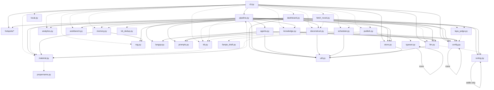

# 短篇小说工作室 · 代码审计报告

> 审计日期：2026-10-25（Asia/Shanghai）
> 审计对象：`E:\小说\短篇` 的 `studio/` 全部 38 个 Python 模块（16,472 行，不含审计期间新增代码）、`launcher.py`、`config.yaml` / `config.example.yaml`、`data/` 关键资产、`prompts/` 全部模板、`tests/` 全部 4 个测试脚本。
> 审计方式：只读静态阅读 + AST 统计 + 本地只读探针（`python -c` 导入、真实成稿样本上跑纯函数）。**未修改任何代码、未调用任何付费 LLM API。**
> 结论摘要：**P0 3 条、P1 14 条、P2 27 条、P3 18 条**。最要命的不是单个 bug，而是三点系统性风险：①全库/全项目 JSON 大量「非原子全量覆写 + 跨进程无锁」；②门禁在 LLM 故障时默认放行（fail-open）；③同一逻辑在 pipeline / agents / dashboard / cli / typeset / kb / rag 各写一遍，已经出现真实的格式互不兼容（番茄排版稿切节）。

---

## 0. 审计快照、范围与限制

### 0.1 快照（重要）

`studio/pipeline.py` 在本审计进行期间**被并发修改**（3453 行 → 3637 行，22:34–22:47 多次落盘）。本报告中的 pipeline 行号统一取自最终核验快照：

| 文件 | 行数 | 说明 |
|---|---|---|
| `studio/pipeline.py` | 3637 | sha1 `13cb90f959dcb2ca456a98276746970c313ace0d`（22:47） |
| `studio/dashboard.py` | 2287 | 自 2026-10-09 未变动 |
| `studio/cli.py` | 1126 | 2026-10-18 起未变动 |
| `studio/kb.py` | 1255 | 2026-10-25 16:40 后未变动 |
| `studio/llm.py` | 1031 | 2026-10-25 21:10 后未变动 |
| `studio/agents.py` | 493 | 2026-10-20 未变动 |
| 其余 32 个模块 | — | 见 §6.4 |

> 若 pipeline 继续被改动，请用 §6.3 的 grep 锚点重新定位；本报告对 pipeline 的每条结论都附了**函数名 + 唯一代码锚点**，不依赖行号仍可复核。
> **快照漂移提示（22:50 复核）**：报告定稿时 pipeline 又被改为 `sha1 b375b1b605458b80a5b1a6056e3ec460d40f2d69`（3573 行）。已逐条复核：§2 的 10 条关键 pipeline 结论**全部仍然存在**（选题索引错位、`project.title`、hybrid 不写 reviews、`repeat_suspect` 丢失、装饰器错挂、report 后补字段、`max_reader_rounds`、`judge_llm` 绕过缓存、门禁 fail-open、双 `word_gate`），只是行号整体下移约 1–64 行（如选题索引错位从 L707→L708、装饰器从 L3117→L3053、report 落盘从 L3592→L3528）。**修复时请以代码锚点为准。**
> 另注：最后一次通过的冒烟测试（`baseline_smoke.log`，22:35:31）是**在 pipeline 22:34 版之后、22:47 版之前**跑的；当前 HEAD（`b375…`）未再验证。

### 0.2 限制

- 只读审计，不执行真实 API；批量测试脚本（`tests/fullprod_batch_test.py`、`tests/genre_batch_test.py`、`tests/repolish_retry.py`）会调真实模型，未运行。
- 工作区里已有 82 个真实项目产物（`workspace/projects/*`），本报告用它们做**真实样本验证**（如 §2.2-B 的番茄稿切节、§2.2-C 的读者画像失配）。
- `workspace/` 下还有大量历史探针脚本（`test_*.py` 等 190+ 个）不属于产品代码，未纳入逐行审计；但其中多处与 `studio/` 逻辑重复，说明「先写探针再补产品代码」的工程习惯已经造成逻辑漂移。

---

## 1. 架构地图

### 1.1 模块职责总表

| 模块 | 行数 | 职责 | 对外主要符号 |
|---|---|---|---|
| `pipeline.py` | 3637 | 阶段编排：抓热点→提梗→选题→知识卡→方案→导语→大纲→圣经→逐章写作→润色体检；所有质量门/字数门/去重启发式都在这里 | `stage_fetch/mine/select/kb/pitch/lead/outline/bible/write/polish`、`word_gate`、`stage_quality_gate`、`assemble` |
| `agents.py` | 493 | 三个 LLM 角色（写手/主编/读者团）+ 每章四道门（禁道具、语言质检、主编、读者/情绪） | `WriterAgent`、`ChiefEditor`、`ReaderPanel`、`_chapter_core`、`_gate_review_reader`、`_gate_emotion` |
| `llm.py` | 1031 | 多 provider 客户端（OpenAI 兼容 / opencode serve / Anthropic / Mock）+ 角色路由 + 用量统计 | `get_llm`、`resolve_llm`、`_build_llm`、`MockLLM`、`usage_summary` |
| `kb.py` | 1255 | 知识单元库：units.jsonl + 向量 KNN + PPMI 共现扩散 + BM25 三路 RRF + MMR/Rerank | `recall`、`add_unit`、`index_pending`、`style_samples`、`lead_patterns`、`arc_skeleton` |
| `dashboard.py` | 2287 | 纯标准库 ThreadingHTTPServer 看板：19 个 GET API、33 个 POST API、1 个内嵌 1200+ 行 HTML/JS 模板 | `serve`、`collect_overview`、`collect_project_detail`、`export_dashboard` |
| `cli.py` | 1126 | argparse 21 个子命令 + 命令分发 + `runlog` 开关 | `main`、`build_parser`、`cmd_*` |
| `langqa.py` | 325 | 零成本确定性语言质检（50 条黑名单 + 词频阈值 + 结构统计 + 禁用道具） | `scan`、`scan_banned`、`banned_terms`、`format_issues` |
| `material.py` | 505 | 素材库 materials.jsonl：沉淀/去重/标签/整理（curate）/digest 反哺 | `deposit_from_project`、`curate`、`digest` |
| `memory.py` | 318 | 记忆层：素材热度/分层/反思守则（memory_rules.json） | `recall`、`reflect`、`memory_brief`、`consolidate` |
| `rag.py` | 263 | 轻量 BM25 RAG（知识卡/素材/教训/拆书四类源） | `build`、`search`、`context_for` |
| `knowledge.py` | 284 | 题材知识卡：Bing/百度搜索→蒸馏→`data/knowledge/*.json` | `build_card`、`load_card`、`digest` |
| `deconstruct.py` | 222 | 拆书：分段→逐段 LLM→全书归纳→写 `workspace/decon/*.json` + 入 kb/素材 | `deconstruct_file`、`split_sections` |
| `typeset.py` | 156 | 番茄排版：标点规范化、切章、草稿文本 | `typeset`、`split_sections`、`draft_text`、`precheck` |
| `publish.py` | 221 | 投稿包/自定义接口/mock/番茄草稿箱四种发布 + `zhihu_format` | `publish`、`build_submission_package`、`zhihu_format` |
| `scheduler.py` | 261 | 定时任务：`schedules.json` + 子进程执行 + 锁/心跳 | `run_job`、`loop`、`build_run_cmd` |
| `analytics.py` | 221 | 阅读数据 mock/custom/import + 趋势 | `fetch_stats`、`compute_trend` |
| `store.py` | 111 | 项目目录/JSON/Markdown 落盘 | `Project`、`create_project`、`latest_project` |
| `config.py` | 158 | 默认配置 + yaml 合并 + 环境变量覆盖 | `load_config`、`data_path`、`prompt_path` |
| `workbench.py` | 306 | 看板写层：config/Agent 提示词/热点源/文稿/项目删除 | `save_config_dict`、`save_agent`、`delete_project` |
| `runlog.py` | 234 | 运行日志：stdout Tee + 阶段计时 + runs.jsonl 索引 | `start`、`staged`、`event`、`end` |
| `pov.py` | 154 | 第一人称人称漂移确定性检查 | **无任何调用方（死模块）** |
| `propername.py` | 116 | 专名清洗（防角色名跨篇雷同） | `build_name_map`、`clean_proper_names`（`clean_legacy_units` 无调用） |
| `laya_judge.py` | 400 | 判别器客户端：laya/self 自训/api 三种后端判重 | `dup_flags`、`route_direction` |
| `laya_server.py` | 156 | 判别器常驻子进程（torch 必须在主线程） | `main` |
| `local.py` | 243 | 本地引擎探测/基准/落地方案 | `detect_engines`、`bench_model`、`snippet_text` |
| `batch_decon.py` | 166 | onehu 原文批量深拆（独立脚本，非 CLI 子命令） | `main` |
| `import_onehu.py` | 115 | onehu HTML 存档导入（独立脚本，硬编码路径） | `run`、`main` |
| `fetch_novel.py` | 339 | 小说站抓取（笔趣阁/起点/onehu）→ 深拆 | `fetch_and_decon` |
| `fanqie_draft.py` | 180 | Playwright 推番茄草稿箱 | `push_draft`、`login` |
| `hotspots/*` | 650 | 9 个热点源适配器 + 聚合去重 | `ADAPTERS`、`fetch_all`、`dedupe` |
| `util.py` / `prompts.py` | 108 / 61 | 通用工具 / 模板渲染 | `extract_json`、`count_words_zh`、`render_prompt` |

### 1.2 依赖关系（import 图）

实线 = 模块级 import；虚线 = 函数内延迟 import（为了绕开循环依赖）。



**结论**：没有硬循环 import（`material ↔ pipeline` 双向都放在函数内），但依赖是「星形 + 延迟导入补丁」结构：`pipeline` 一个文件依赖 13 个模块、`cli` 延迟导入 15 个模块、`dashboard` 延迟导入 8 个模块。后果是：①任何模块改名/改签名都要全仓 grep；②`pipeline` 的 import 语句分布在函数体里，静态工具（`vulture`、`mypy`、IDE）很难发现死代码（`pov.py` 就是这样变成死模块的）；③`material` 在函数内 `from .pipeline import match_direction`，而 `pipeline` 又在函数内 `from . import material`——一旦未来有人在模块级加 import 就会立刻循环崩溃。

### 1.3 project.json 状态机与阶段落盘契约

`store.py:10` 定义了 `STAGES`，但**业务代码从未读取这个常量**（见 §3.2）；实际状态机由各 stage 自己 `project.has(file)` + `project.set_stage(key)` 隐式维护：

| # | 阶段 | 入口函数 | 续跑判据（存在即跳过） | 落盘产物 | `project.json.status` 键 | 下游消费者 |
|---|---|---|---|---|---|---|
| 1 | 抓热点 | `stage_fetch` `pipeline:271` | `hotspots.json` | `hotspots.json` | `hotspots` | mine、material 转换、看板 |
| 2 | 提梗 | `stage_mine` `pipeline:292` | `concepts.json` | `concepts.json` | `concepts` | select |
| 3 | 选题 | `stage_select` `pipeline:671` | `concept.json` | `concept.json` | `concept` | 后续所有阶段 |
| 4 | **知识卡** | `stage_kb` `pipeline:735` | `kb.json` | `kb.json` | **无（`STAGES`/看板都缺这个键）** | pitch/ctx/bible |
| 5 | 书名方案 | `stage_pitch` `pipeline:839` | `pitch.json` | `pitch.json` | `pitch` | lead/outline/bible/写作/polish/发布 |
| 6 | 导语 | `stage_lead` `pipeline:961` | `lead.json` | `lead.json`（含 `gate`） | `lead` | polish 装配、material 沉淀 |
| 7 | 大纲 | `stage_outline` `pipeline:1070` | `outline.json` | `outline.json` | `outline` | bible/write/assemble/material |
| 8 | 圣经 | `stage_bible` `pipeline:1182` | `bible.json` | `bible.json` | `bible` | ctx/write/material/pov(声称) |
| 9 | 逐章写作 | `stage_write` / `_stage_write_hybrid` | 逐章 `chapters/chNN.md` 存在 | `chapters/chNN.md`、`reviews/chNN.json`、`project.json.reviews/chapters_state/emotions` | `chapters` | polish/看板/复盘 |
| 10 | 润色体检 | `stage_polish` `pipeline:3145` | `report.json`（`--refresh-polish` 强制） | `report.json`、`final/成稿.md`、`final/成稿.txt`、`submission/*`（publish 时） | `final` | publish、analytics、improve、看板 |

**契约问题（按严重度）**：
1. `stage_kb` 只写 `kb.json`，**不 `set_stage`**，看板 `STAGE_KEYS`（`dashboard.py:178`）也没有 `kb` → 用户看不到知识卡是哪一步、是否失败（§2.3-19）。
2. `stage_write` 的落盘是「先写章节文件、再写 reviews、最后 `save_meta`」三段式；任一步被打断，`project.json` 与 `reviews/*.json` 与 `chapters/*.md` 三者不一致（§2.1-1、§2.2-7）。
3. `stage_polish` 的 `report.json` 在 `pipeline:3592` 落盘后仍有字段被追加（§2.2-9）。
4. `_stage_write_hybrid` 只在 `project.json.reviews` 写 `{"gate":"hybrid"}`（`pipeline:1419`），**根本不写 `reviews/chNN.json`**（唯一写点是 `pipeline:2115`，属于 agent 模式）→ hybrid 项目的复盘/看板/素材教训全部读不到（§2.2-7）。

### 1.4 端到端数据流

```
CLI(main) ──► cmd_run/cmd_continue/cmd_produce
  │             │
  │             ├─ pipeline.stage_fetch  ──► hotspots.fetch_all(9源, ThreadPool) ──► hotspots.json
  │             ├─ pipeline.stage_mine   ──► 历史查重(recent_tropes/axes + Laya/LLM) + material.digest + memory.brief
  │             │                            └─► concepts.json
  │             ├─ pipeline.stage_select ──► 规则/Laya/LLM 三级查重 + 禁用道具筛选 ──► concept.json
  │             ├─ pipeline.stage_kb     ──► knowledge.load_card/build_card(搜索+LLM蒸馏) ──► kb.json
  │             ├─ stage_pitch ─► stage_lead ─► stage_outline ─► stage_bible（每步都有 stage_quality_gate 双门）
  │             ├─ stage_write：每章 _chapter_core（写手+字数+禁道具+langqa）
  │             │      → ThreadPool 并行 _gate_review_reader（主编+读者团）
  │             │      → 串行 _gate_emotion（情绪门）→ chapters/chNN.md + reviews/chNN.json
  │             └─ stage_polish：word_gate(字数门) → 3×低温度体检取中位 → 修复循环(补丁/逐节去味/整稿重写)
  │                    → 全稿读者团(可整稿重写) → 再跑 word_gate → _final_clean 装配 → report.json + final/*
  │
  ├─ publish（manual/custom/mock/fanqie_draft）──► submission/*、publish.json
  ├─ analytics fetch/import ──► workspace/analytics/<project>/<ts>.json
  └─ improve ──► workspace/feedback_lessons.json ──► 下次 mine 注入（lessons_digest）
           └─► material.deposit_from_project ──► materials.jsonl ──► memory/rag/KB
                    └─► memory.reflect ──► memory_rules.json ──► 下次 mine 注入
```

关键观察：**写作层的输出（章节）与展示层（看板）、数据层（reviews/report）、反哺层（素材/记忆/教训）之间是「字符串键」耦合**（`"gate"`、`"maxed_*"`、`"hybrid"`、`"pass"`、`"issues"`），没有集中定义的 schema；新增一个门禁只需在 `agents.py` 塞字符串，但看板/测试/素材抽取会静默漏读（§3.3）。

### 1.5 运行时拓扑与并发模型

```
python -m studio dashboard (ThreadingHTTPServer, 127.0.0.1:8600)
  ├─ HTTP handler 线程池（每请求一线程，无鉴权，仅回环）
  │    ├─ POST /api/generate     → 新线程里 sch.run_job() → subprocess `python -m studio run ...`
  │    ├─ POST /api/deconstruct  → 新线程 dec.deconstruct_file（直接写 kb/units.jsonl）
  │    ├─ POST /api/novel-fetch  → 新线程 fetch_novel
  │    ├─ POST /api/kb/dedup     → 新线程 kb_dedup.scan/apply（压实 units.jsonl + vectors.npy）
  │    └─ POST /api/schedules/run→ subprocess `python -m studio schedule run`
  ├─ 全局可变状态：DECON_STATE / DEDUP_STATE / FETCH_STATE / GEN_RUNNING / _LAYA_STATUS_CACHE / CFG_FILE
  └─ runlog._Tee（整个进程 stdout 被替换为无锁 Tee 写文件）

python -m studio run（另一个进程）
  └─ ThreadPoolExecutor(max_workers=pipeline.max_parallel) 并行每章 review/reader
       └─ 共享同一 WriterAgent/Editor/LLM 实例（requests.Session 跨线程共享）
  └─ runlog 模块级 _state（无锁，线程内 += 计数）

python -m studio scheduler（第三个进程）
  └─ loop → run_job → 写 .scheduler_lock → subprocess `python -m studio run/produce`
```

**并发结论**：三个进程可以同时写同一 `workspace`，而锁只有三处且都是进程内或「文件存在即锁」：`kb._IO_LOCK`（进程内 RLock，`kb.py:279`）、`.scheduler_lock`（`scheduler.py:198`，无超时/stale 检测）、`DEDUP_STATE/DECON_STATE.running`（进程内标志）。**没有跨进程文件锁、没有原子写、没有版本号**（§2.1）。

### 1.6 资产消费表（data/ 与 prompts/）

| 资产 | 消费方 | 状态 |
|---|---|---|
| `data/tropes.json` | pipeline/knowledge/material/dashboard/novelsources/cli | ✅ 42 方向，被使用 |
| `data/genre_chains.json` | `pipeline.genre_chain` | ⚠️ 11 族 + 19 组合；**3 个组合的 `parts` 写成了题材名 `悬疑智斗` 而非族键 `悬疑诡计`，永远匹配不到**（§2.3-10） |
| `data/platforms.json` | pipeline/publish/cli | ⚠️ `uc`/`qimao` 无 `format` 字段，polish 走 else 分支（丢导语） |
| `data/readers.json` | `agents.ReaderPanel` | ❌ `affinity` 用题材 **id**（`poxi`），代码用题材 **name**（`婆媳大战`）比较 → 亲和力永远为空（§2.2-3） |
| `data/lang_rules.json` | langqa | ✅ 50 条黑名单 + 12 类词频 |
| `data/character_templates.json` | stage_pitch | ✅ |
| `data/style_guide.md` | `_chapter_ctx` 每章注入 | ✅ 但 40KB 每章全文进 prompt，token 成本高（§2.3-20） |
| `data/material_tags.json` | `material._tag_rules` | ✅ |
| `data/genres.json` | `kb.tag_genres` | ✅ |
| `data/fanqie_strategy.md` | **无** | ❌ 孤立资产（§3.2） |
| `data/knowledge/*.json` | knowledge/rag/dashboard | ✅ 42 张卡与 42 个方向一一对应 |
| `prompts/*.md` 35 个 | 33 个被 `render_prompt/load_prompt` 消费 | ❌ `write_section.md` 无任何调用（§3.2） |
| `prompts/genre_*.md` 6 个 | 经 `config.knowledge.genre_guides` 映射 + `load_genre_guide` | ✅ 但 `genre_xiuxian.md` 的 TASK 标记写成了 `GENRE_GUIDE`（复制粘贴残留，不影响渲染） |

---

## 2. 真实缺陷清单

> 每条格式：**现象 → 根因 → 定位 → 修复建议**。优先级按「造成不可恢复损失 / 静默产出错稿 / 影响可维护性」排序。

### 2.1 P0（会造成数据丢失或静默产出未过门禁的成稿）

#### P0-1 全库/全项目 JSON 是「非原子全量覆写」，崩溃即截断，备份只保一处
- **现象**：`materials.jsonl`、`units.jsonl`（`kb tag` 路径）、`project.json`、`schedules.json`、`memory_rules.json` 都是 `Path.write_text()` 直接覆盖；断电/Ctrl+C/磁盘满/进程被杀时文件被截成半截。`add_unit` 用 append + 补换行来容忍撕裂行（`kb.py:326-332`），但 `kb.tag_all` 是**读全量→重写**（`kb.py:1070-1102`），`kb_dedup.apply` 也是重写（`kb_dedup.py:200-203`，用了 `os.replace` 但 tmp 名固定），`material._save`（`material.py:72-78`）与 `store.save_meta`（`store.py:28-34`）完全没有临时文件。
- **根因**：没有统一的原子写工具；`.bak` 只在部分路径做（`material._save` 有、`store.save_meta` 没有）。
- **定位**：`material.py:72-78`、`store.py:28-39`、`scheduler.py:46-49`、`kb.py:1097-1101`、`kb_dedup.py:200-203`、`memory.py:277-281`。
- **修复**：在 `util.py` 加 `atomic_write_text(path, text)`（同目录 `.<name>.tmp` + `os.replace` + `fsync`），替换以上所有 `write_text`；`add_unit` 保留 append 但写前 `FlushFileBuffers`。一行级示例：
  ```python
  def atomic_write_text(p: Path, s: str):
      tmp = p.with_name(p.name + ".tmp")
      with open(tmp, "w", encoding="utf-8") as f:
          f.write(s); f.flush(); os.fsync(f.fileno())
      os.replace(tmp, p)
  ```

#### P0-2 多进程并发写同一 workspace，全部依赖进程内锁
- **现象**：看板可同时触发「生成（子进程）」「深拆（线程）」「知识库去重（线程）」；调度器也会拉起子进程；用户还可能另开一个 `run`。`schedules.json` 的读改写（`dashboard.py:892-932`、`scheduler.py:46-49/193-197/234-245`）在两边同时发生时会**互相覆盖**（后写者赢），表现为「刚建的定时任务消失」「last_run 不更新」；`project.json` 的 `set_stage` 是 read-modify-write（`store.py:36-39`），两个 stage 并发时丢状态。`kb._IO_LOCK` 只在单进程有效（`kb.py:279`）。
- **根因**：设计上假设「一个用户一次只跑一件事」，但看板/调度器/CLI 已经是三个写方；`.scheduler_lock` 只保护「调度任务之间」，不保护 CLI/看板。
- **定位**：`store.py:22-39`、`scheduler.py:46-49`、`dashboard.py:740-788`、`dashboard.py:861-885`、`kb.py:279`。
- **修复**：①`workspace/.studio.lock` 跨进程文件锁（`msvcrt.locking` / `filelock` 手写 `os.open(..., O_CREAT|O_EXCL)` + 陈旧超时）；②所有 mutating API 在锁内执行；③`save_schedules`/`save_meta` 读改写加「同目录锁 + 原子写」；④看板 POST 返回 409 而不是继续排队。

#### P0-3 门禁 fail-open：LLM 一失败，所有质量门「静默通过」
- **现象**：主编审查解析失败 → `{"verdict":"pass","score":7.0}`（`agents.py:92-96`）；情绪门失败 → `pass`（`agents.py:198-204`）；读者团单人失败 → `7.2` 保守中下分（`agents.py:122-125`）；阶段达标门评审失败 → **`return 10.0, ""`（直接满分放行）**（`pipeline.py:2333`，锚点 `return 10.0, ""`）；全稿体检连续失败 → `mode="local-stats", score=70` 并**跳过修复循环**（`pipeline.py` `_do_check`/异常分支）。这些路径不写 `runlog.error`，在无人值守的 `produce`/`scheduler` 场景下，用户会拿到一份「门禁全 pass」但实际没审过的稿子。
- **根因**：把「LLM 不可用」与「稿件合格」混为一谈；为了流水线不中断选择 fail-open，但没有降级标记与告警。
- **定位**：`agents.py:92-96`、`agents.py:198-204`、`agents.py:122-125`、`pipeline.py:2333`、`pipeline.py` 体检降级分支（锚点 `体检输出异常，降级为本地统计`）。
- **修复**：①把「评审失败」建模为 `gate="error"`（而非 pass），在 `report["degraded"]=[...]` 汇总；②`runlog.event(..., level="error")` 并让 `cmd_produce`/scheduler 根据 `degraded` 决定退出码；③阶段门失败返回值改为 `(None, "评审不可用")`，由调度决定「重试 / 阻塞 / 人工确认」，至少不要返回 10.0。

### 2.2 P1（核心链路正确性 / 数据一致性 / 关键功能静默失效）

#### P1-1 选题阶段：禁用道具筛选后，查重标志与候选列表**索引错位**
- **现象**：`ranked` 先按分排序，`rule_flags`/`sem_flags` 按此顺序计算（`pipeline:690-698`）；随后命中禁用道具的梗卡被过滤成 `_clean` 并赋回 `ranked`（`pipeline:707`），但标志数组没有同步过滤。最终 `for k, cand in enumerate(ranked): if rule_flags[k] ...`（`pipeline:709`）拿旧索引判新列表 → **可能跳过一张全新梗卡，或放行一张与历史重复的梗卡**（取决于被筛掉的位置）。
- **根因**：三个平行数组（ranked/rule_flags/sem_flags）靠下标隐式对齐，中途 `ranked` 被重新赋值。
- **定位**：`pipeline.py:686-714`（锚点 `ranked = _clean`、`if rule_flags[k]`）。
- **修复**：不要在列表上做平行数组；改成 `ranked = [dict(c, _dup=bool(f1 or f2)) for c,f1,f2 in zip(...)]` 先合并标志，再做禁用道具过滤，最后按 `not c["_dup"]` 选择。

#### P1-2 番茄/七猫投稿包的章节切分与写作层格式**互不兼容**（真实样本可复现）
- **现象**：`stage_polish` 对 fanqie/qimao 平台用 `keep_titles=True` 输出「`NN 标题`」节头（`pipeline.py:3497/3500`，锚点 `keep_titles=_keep_titles`）；但 `typeset.split_sections` 只认「`第N章 标题`」或「`NN、标题`」两种形态（`typeset.py:70-74`），**不认 `01`，也不认 `01 标题`**。实测：真实成稿 `final/成稿.txt` 的 6 个「01…06」节头被完全忽略，按 2000 字自动重切成 5 段无标题章节（另一个失控样本被切成 59 段）。投稿包的「03_番茄排版稿」因此章节边界错、标题全丢；而 `01_正文.txt` 又被 `publish.build_submission_package` 无脑套 `zhihu_format`（`publish.py:65`）把节头标题删掉。**用户拿到的番茄投稿包不可直接粘贴。**
- **根因**：节头解析在 `pipeline._SEC_HEAD`、`pipeline._SEC_HEAD_TITLE`、`typeset.split_sections`、`deconstruct.SECTION_MARK`、`langqa`、`pov._SEC_HEAD` 共 5 处各写一份正则；改一处不会同步其它处。审计期间 pipeline 刚把 `_SEC_HEAD` 收紧到 v5 严格版（`pipeline.py:2267`），typeset 仍是旧版。
- **定位**：`typeset.py:65-103`（锚点 `0?\\d{1,2}\\s*[、.．]`）、`pipeline.py:3497-3500`、`publish.py:63-105`。
- **修复**：新建 `studio/heads.py` 唯一实现 `is_section_head(line) -> (no,title)|None`，五处全部 import；`typeset` 增加对「`NN`」「`NN 标题`」的识别；`publish` 按 `platform` 选择 `zhihu_format` 或番茄规范化，不要无条件 zhihu 化。

#### P1-3 读者团「题材亲和力」永远失配，画像顺序固定
- **现象**：`ReaderPanel.__init__` 用 `direction in r.get("affinity", [])` 选画像（`agents.py:104-107`），`direction` 是题材**中文名**（如「婆媳大战」），而 `data/readers.json` 的 `affinity` 全是题材 **id**（`poxi`/`caili`/…，`readers.json:9,18,27…`）。实测：`prefer` 永远为空 → 每个项目都取前 `reader_panel`（3）个画像，甚至可能把「弃稿率极高的老书虫」选进评审团。
- **根因**：id/name 双轨没有归一化函数（`kb` 有 `_direction_match`，agents 没用）。
- **定位**：`agents.py:104-107`、`data/readers.json:9-66`。
- **修复**：`ReaderPanel` 里先把 direction 通过 `pipeline._guide_query_terms`/tropes 表转 id（或把 readers.json 的 affinity 改成 name），并对为空的情况给出可见告警。

#### P1-4 任意非梗库 `--direction` 会在知识卡阶段 `SystemExit`，整条 run 中断
- **现象**：`knowledge.direction_meta` 找不到方向时 `raise SystemExit(...)`（`knowledge.py:42-48`）；`pipeline.stage_kb` 直接 `card = knowledge.load_card(direction)`（`pipeline.py:781`），未捕获。用户 `run --idea X --direction 修仙×短剧改编`（config 的 genre_guides 明明支持「修仙」）会在选题后崩掉——tropes.json 里没有「修仙」这个方向名，只有「怪诞修仙脑洞」。
- **根因**：知识卡以「梗库方向」为唯一合法 key，但 CLI/`--direction`/combo 允许自由文本；SystemExit 被当作控制流抛到最外层。
- **定位**：`knowledge.py:42-48`、`pipeline.py:781`、`cli.py:203-205`。
- **修复**：`load_card` 未知方向返回 `None` 并回退「无卡 + LLM 内化」路径；或在 CLI 入口用 tropes 表校验并给出候选列表。

#### P1-5 知识单元 ID 用「当前去重集合大小 +1」，去重/压实/并发后会**撞 ID**
- **现象**：`add_unit` 生成 `"id": "U" + f"{len(seen)+1:06d}"`（`kb.py:316`）。`seen` 是「指纹集合」，一旦：①`kb_dedup.apply` 重排 ID（`kb_dedup.py:198-199`）；②`kb tag` 重写；③两个进程同时入库；④手工删行——新 ID 就会与既有 ID 重复。重复 ID 会让 `id2unit` 字典覆盖（`kb.py:764`、`kb.py:578`），向量行与单元错配，召回结果指向错误文本。
- **根因**：把「数量」当唯一键；没有持久化 `next_id` 计数器。
- **定位**：`kb.py:299-336`、`kb_dedup.py:184-234`。
- **修复**：`offsets.json` 里持久化 `next_id`，`add_unit` 在 `_IO_LOCK` 内自增；或直接用 `uuid4().hex[:12]`（去重仍靠 `fp`，ID 不再承担顺序语义）。

#### P1-6 调度器锁文件无陈旧检测，一次崩溃永久阻塞所有定时任务
- **现象**：`run_job` 只判断 `lock.exists()` 就 `skipped`（`scheduler.py:198-202`）；进程被 kill/断电后 `.scheduler_lock` 留在磁盘上，之后每次调度都跳过，**直到人工删文件**。看板只显示「已有任务运行中」。
- **根因**：锁无 owner/心跳/超时。
- **定位**：`scheduler.py:198-202`、`scheduler.py:245`。
- **修复**：锁文件写 `{pid, ts}`，`exists` 后校验 pid 存活与时间戳（> 任务最长耗时就视为陈旧并接管），或改用跨进程文件锁（见 P0-2）。

#### P1-7 hybrid 模式只写 `project.json.reviews` 不写 `reviews/chNN.json`，下游全读空
- **现象**：`_stage_write_hybrid` 每章只做 `meta.setdefault("reviews", {})[str(no)] = {"gate": "hybrid"}`（`pipeline.py:1419`），**不写 `reviews/chNN.json`**；唯一写 reviews 文件的是 agent 模式（`pipeline.py:2115`）。而 `dashboard.collect_project_detail`（`dashboard.py:359-372`）、`material.deposit_from_project`（`material.py:303-321`）、`tests/fullprod_batch_test.py:98-115`、`tests/repolish_retry.py:95-112` 全部按章读 `reviews/chNN.json` → hybrid 项目在复盘/看板/测试里显示 0 章、0 门禁。同时 hybrid 模式**不做任何逐章门禁**（只有整稿 polish），但 `report["review"]["chapters"]` 仍会把 `"hybrid"` 当作一种 gate 写进汇总，用户容易误读为「每章都过了门」。
- **根因**：两种写作模式的落盘契约没有统一。
- **定位**：`pipeline.py:1386-1425`（锚点 `{"gate": "hybrid"}`）、`pipeline.py:2115`、`dashboard.py:359-372`。
- **修复**：hybrid 也落盘 `reviews/chNN.json`，内容明确为 `{"gate":"skipped_hybrid","reason":"hybrid 模式不做逐章门禁"}`；看板/复盘按 `gate` 分支显示，而不是当作 pass。

#### P1-8 跨章重复标记 `repeat_suspect` 在 `save_meta` 之后写入，最后一章永远丢失
- **现象**：循环内先 `project.save_meta(meta)`（`pipeline.py:2125`），随后才 `meta["reviews"][str(no)]["repeat_suspect"] = True`（`pipeline.py:2148`）。只有当后面还有下一章时才会被下一次 `save_meta` 顺带写盘；**最后一章的标记一定丢**。看板/复盘看不到「疑似情节重复」。
- **根因**：状态写入顺序错误（先落盘后改内存）。
- **定位**：`pipeline.py:2125/2148`（锚点 `repeat_suspect`）。
- **修复**：把 `repeat_suspect` 的检测与写入挪到 `save_meta` 之前；或检测完后统一再 `save_meta` 一次，并在循环结束后补一次 flush。

#### P1-9 `report.json` 落盘后仍有字段追加，`account_trope_warn` 永远读不到
- **现象**：`project.save_json("report.json", report)` 在 `pipeline.py:3592`；之后 `report["account_trope_warn"] = acc`（`pipeline.py:3634`）并 `return report`。磁盘上的 report.json 永远没有这个字段（返回值有，但 CLI 不落盘）；下一次 `stage_polish` 直接 return 读盘结果，告警信息丢失。
- **根因**：同一函数内「先持久化、后补字段」。
- **定位**：`pipeline.py:3592` 与 `pipeline.py:3634`（锚点 `account_trope_warn`）。
- **修复**：把账务词检测挪到 `save_json` 之前，或保存后再 `save_json` 一次；推荐把「报告组装」与「报告落盘」拆成两步，最后统一写。

#### P1-10 装饰器挂错函数：`@runlog.staged("润色体检")` 挂在 `_apply_patches` 上
- **现象**：`pipeline.py:3117` 的 `@runlog.staged("润色体检")` 紧邻 `_apply_patches`（`pipeline.py:3118`），而真正的 `stage_polish`（`pipeline.py:3145`）**没有** stage 装饰器。后果：运行日志里「润色体检」这个阶段每一轮补丁都会被记录一次（同名阶段多次出现、耗时为补丁耗时），真正的润色总耗时/成败没有记录；`stage` 异常也不会被 `runlog.stage` 捕获打 traceback。
- **根因**：函数插入位置变更时装饰器跟着位移，没有测试跑 `runlog.list_runs()` 断言阶段名。
- **定位**：`pipeline.py:3117-3118`、`pipeline.py:3145`。
- **修复**：删掉 `_apply_patches` 上的装饰器，移到 `stage_polish` 定义前；补一条「阶段计时表包含 润色体检」的测试。

#### P1-11 `ThreadPoolExecutor` + 共享 `requests.Session` / 全局用量 / runlog 状态：线程不安全
- **现象**：`stage_write` 用线程池并行跑每章 review+reader（`pipeline.py:2038-2042`，锚点 `ThreadPoolExecutor`），但 `WriterAgent/ChiefEditor/ReaderPanel` 共用同一个 LLM 实例（`resolve_llm` 返回 `_LLM_CACHE` 单例，`llm.py:986-998`），而 `OpenAICompatLLM.session` 是 `requests.Session`——官方不保证线程安全；`USAGE_LOG.append`、`runlog._state["llm_calls"] += 1`（`runlog.py:116-122`）是非原子的读改写，高并发下丢计数；`_Tee.write` 无锁（`runlog.py:37-48`），多线程同时 print 可能把日志行写花。实际表现是偶发 `ConnectionReset`/token 统计偏少/日志错行，很难复现。
- **根因**：为吞吐引入线程，但依赖库（requests）与全局状态没有按线程隔离。
- **定位**：`pipeline.py:2038-2042`、`llm.py:129-148`、`llm.py:986-998`、`runlog.py:37-48/116-122`。
- **修复**：①每线程 `_build_llm` 独立实例（参考 `batch_decon._worker_llm` 的 thread-local 做法，`batch_decon.py:46-56`）；②`USAGE_LOG` 用 `threading.Lock`；③`_Tee.write` 加锁；④或直接改回串行（每章门禁原本就是网络 IO，3 并发对云端 API 的收益有限）。

#### P1-12 看板保存 Agent 提示词只校验 `===USER===`，不校验 `===SYSTEM===`
- **现象**：`workbench.save_agent` 只检查 `if "===USER===" not in raw: return error`（`workbench.py:186-199`）。用户在看板删掉/改坏 `===SYSTEM===` 分隔符后保存成功，下一次 `load_prompt` 执行 `text.split("===SYSTEM===", 1)` 抛 `ValueError`（`prompts.py:18-28`）→ **整条 run 在最开始就崩**，且报错信息是底层 split 异常。
- **根因**：保存时校验不完整；`load_prompt` 没有友好错误。
- **定位**：`workbench.py:186-199`、`prompts.py:18-28`。
- **修复**：保存时同时校验 SYSTEM/USER 且顺序正确、`<!--TASK:` 存在；`load_prompt` 捕获后 `raise SystemExit(f"prompt {task} 格式错误：缺少 SYSTEM/USER 分隔符")`。

#### P1-13 `continue` 会为「直接写」项目重新生成 outline，进而破坏成稿装配
- **现象**：direct 模式只写 `chapters/ch01.md` + 极简 `pitch.json/bible.json`，没有 `outline.json`；`cmd_continue` 无条件执行 `stage_pitch → stage_lead → stage_outline → stage_bible → stage_write`（`cli.py:352-376`）。虽然 `stage_write` 因 ch01 存在会跳过，但 `outline.json` 已被生成；之后 `stage_polish` 的 direct 分支条件是 `not project.has("outline.json")`（`pipeline.py` 锚点 `直接写模式`），不再成立 → 走正常 `assemble`，给整篇 direct 成稿加上「01 标题」并重新编号，导语被当成第 1 节。**续跑一次就把 direct 稿的版式改坏。**
- **根因**：阶段编排不区分项目产出模式（direct/hybrid/agent）；`project.json` 里没有 `mode` 字段。
- **定位**：`cli.py:352-376`、`pipeline.py`（`stage_polish` 开头 direct 判断，锚点 `没有 outline.json`）。
- **修复**：`project.json` 增加 `"mode": "direct|hybrid|agent"`；`continue` 按 mode 只跑剩余阶段；`stage_polish` 用 mode 而不是「outline 文件是否存在」判断。

#### P1-14 `fanqie_draft` 的独立 CLI 入口 import 了不存在的 `load`
- **现象**：`python -m studio.fanqie_draft login/push` 执行到 `from .config import load`（`fanqie_draft.py:155`），而 `config.py` 只有 `load_config` → `ImportError`。文档（模块 docstring 第 14-17 行）明确宣传了这个用法，但从未跑通。
- **根因**：重构 `load`→`load_config` 时漏改；没有测试覆盖 `__main__` 入口。
- **定位**：`fanqie_draft.py:155`。
- **修复**：改为 `from .config import load_config as load`；补一条 `python -m studio.fanqie_draft`（无参数）应打印用法而不是 ImportError 的测试。

### 2.3 P2（状态一致 / 性能 / 可观测 / 边界条件）

| # | 缺陷 | 定位 | 修复要点 |
|---|---|---|---|
| 1 | `report["review"]["chapters"]` 用 `project.meta` 快照（`pipeline:3504`），而 `reviews/chNN.json` 才是门禁明细；两者在 hybrid/中断时不同步 | `pipeline.py:3504`、`dashboard.py:359-372` | report 只存引用路径或统一从 reviews 目录重建 |
| 2 | 配置 `review.max_reader_rounds: 1`（`config.yaml:77`）让全稿读者「低分打回整稿重写」循环**一次都不执行**（`while avg<threshold and rnd<max_r`，`pipeline:3485`）→ 读者团只评分不修复，却打印 `maxed_reader` | `config.yaml:77`、`pipeline.py:3485`（锚点 `max_r = int(cfg["review"].get("max_reader_rounds"`） | 默认改成 2；或循环条件改为 `rnd <= max_r` 并重命名语义 |
| 3 | 评分实例 `_build_llm(_judge_cfg, "judge:stable")` 绕过 `_LLM_CACHE`/角色路由（`pipeline:3184`），`role` 保持 `"anon"` → 用量统计出现 `anon(model)`，且每篇新建连接池/会话 | `pipeline.py:3184` | 走 `get_llm` 角色并设 `temperature` 覆盖；或设 `inst.role="reviewer:judge"` |
| 4 | `word_gate` 跑两次（`pipeline:3162` 与 `pipeline:3525`），第二次的 `wg` 覆盖第一次，report 只留第二次统计 | `pipeline.py:3162/3525`（锚点 `full, wg = word_gate`） | 合并为一次「装配前复核」，把两次结果都记进 `report["word_gate"] = {"first":..., "final":...}` |
| 5 | `_final_clean` 的节头启发式仍可能吞正文：短行「3 年了」「2 块钱」在严格正则下仍会被判成节头；若编号 ≤ 已出现编号，整行被 `continue` 丢弃（`pipeline:1546-1549`）。与 typeset 的节头解析并存，属重复实现（P1-2 根因） | `pipeline.py:1512-1570`（锚点 `丢弃`/`_n_drop`） | 节头判定统一到 `heads.py`；对「丢行」打印样例行数并写 `report["clean_dropped"]`，超过阈值告警 |
| 6 | `material.curate` 的落盘过滤是死条件：`or not x.get("_trash_done")` 恒真（`material.py:443`），且每个 batch 都 `_load_trash()+_save()` 全库重写（`material.py:442-443`） | `material.py:442-446` | 删除死条件；只在循环结束 `_save` 一次 |
| 7 | `memory.recall` 过滤条件写 `it.get("quality") != "低"`（`memory.py:102`），而全库 quality 值是 `high/mid/low` → 过滤恒真，低质素材仍会被召回 | `memory.py:102` | `!= "low"`，并用 `QUALITY_WEIGHT` 统一 |
| 8 | `match_direction`（`pipeline:235`）与 `_log_dup_decisions`（`pipeline:417`）重新 `load_config(None)`，**忽略 `--config` 与看板注入的 cfg** → 查重标注写到默认 workspace 的 `kb/dup_decisions.jsonl`；Laya 路由读默认 config 的 laya 配置 | `pipeline.py:235,417` | 接受 `cfg` 参数并透传；`make_idea_concept` 等调用点同步 |
| 9 | `OpenAICompatLLM` 流式失败一次后 `self.stream = False` **永久关闭**流式（`llm.py:216`）；4xx 时 `payload.pop("response_format"/"reasoning_effort"/"thinking")` 永久移除，后续所有调用都失去 json_mode/关思考 | `llm.py:212-235` | 失败降级只对本次请求生效（用局部 payload 副本），或恢复时重建客户端 |
| 10 | `genre_chains.json` 三个 combo 的 `parts` 写成题材名（`悬疑智斗`）而 `_family_of` 匹配族键（`悬疑诡计`）→ 该组合永远走 `_merge_chains` 动态合成，融合链（`fusion`）用不上 | `data/genre_chains.json`（`悬疑智斗×言情情感`、`悬疑智斗×规则怪谈`、`穿越穿书×悬疑智斗`）、`pipeline.py:99-112` | 把 parts 改为族键；或 `_family_of` 支持「题材名→族」的反查 |
| 11 | `kb_dedup.py` 开头有 UTF-8 BOM（唯一一个 BOM 文件），`ast.parse(读取文本)` 会报 `invalid non-printable character U+FEFF`，部分工具链/静态检查会失败；同文件 `find()` 定义了两次（`kb_dedup.py:125` 与 `132`），第一份是死代码 | `kb_dedup.py:1`、`125/132` | 去 BOM；删重复 `find` |
| 12 | `kb_dedup.scan` 的语义分支要求 `len(embs) == len(units)` 才继续（`kb_dedup.py:121`），embedding 中途失败时静默跳过语义去重（只有一行 print），但 stats 仍显示 `semantic_groups=0`，用户会以为「没有语义重复」 | `kb_dedup.py:110-122/175-180` | stats 增加 `semantic_skipped: true` 与原因 |
| 13 | `kb.load_units` 的进程内缓存被 `kb_dedup.scan/apply` **就地修改**（写入 `_old_id`、重排 id，`kb_dedup.py:59-64/198-199`）→ 同进程后续 `load_units` 返回的 dict 带 `_old_id`，序列化会把脏字段写回 | `kb.py:189-205`、`kb_dedup.py:59-64,198-199` | scan/apply 深拷贝（`copy.deepcopy`）或 `dict(u)` 后再改 |
| 14 | 配置死键：`studio.chapters`（`config.py:31`）从未被读；`rag.max_chars`（`config.py:79`）从未被读（调用点全传字面量 520/900）；`decon.per_call`（`config.py:83`）从未被读（CLI/代码全是默认 2）；`llm_cloud_backup` 整段是注释用途（`config.yaml:203-217`）。`config.example.yaml` 比 `config.yaml` 少 `kb/pipeline/materials/decon/laya` 等大段，`publish.mode` 也没写 `fanqie_draft` → 新用户照抄 example 会缺配置 | `config.py:27-95`、`config.example.yaml`、`config.yaml:203-217` | 要么接线（读键），要么删键；example 与 DEFAULT_CONFIG 做一次一致性测试 |
| 15 | `cmd_produce` 的 `with_improve = args.with_improve or data_source != "none"`（`cli.py:677`）：`--data-source` 默认 `mock`，所以**每次都跑复盘改进**，与 help「--with-improve 复盘改进（数据回流后自动）」不符，无谓多耗 LLM | `cli.py:659-750` | 默认 `data_source=none` 或严格按 `--with-improve` |
| 16 | 看板导出把 JSON 直接 `TEMPLATE.replace("__PAYLOAD__", data_json)`（`dashboard.py:1052-1054`）：正文/素材里若出现 `</script>` 会截断脚本、页面白屏（也构成 XSS 面） | `dashboard.py:1052-1054` | `json.dumps(..., ensure_ascii=True).replace("</", "<\\/")` 或用 `<script type="application/json">` + `textContent` |
| 17 | 看板/调度器拉起的子进程没有 `cwd`（`dashboard.py:943-947`、`scheduler.py:136-186` 只用 `sys.executable -m studio`）。从非项目根目录启动看板/调度器时，子进程 `ModuleNotFoundError: studio`，且 `stdout=DEVNULL` 完全静默 | `dashboard.py:943-947`、`scheduler.py:136-186` | `subprocess.Popen(..., cwd=str(ROOT))`，并把 stderr 写入 `workspace/logs` |
| 18 | `publish.build_submission_package` 细节问题：`import re` 重复（`publish.py:17-18`）；`project.load_json("pitch.json")` 连续读两次（`publish.py:57`）；`01_正文.txt` 无条件 `zhihu_format`（`publish.py:65`）；mock work_id 用进程级随机化的 `hash()`（`publish.py:148`）→ 每次跑都不同，不可回归 | `publish.py:17-18,57,65,148` | 清理重复/双读；按平台格式化；work_id 用 `hashlib.md5(title)` |
| 19 | `material.deposit_from_project` 每条素材都 `add_material` → 内部 `_load`+`_save` 全库读写（`material.py:109-135`），一次成稿沉淀 20-60 条 = 20-60 次全文件重写 + `.bak` 拷贝，素材库越大越慢 | `material.py:336-375`、`material.py:56-78` | 批量 API：先 `_load` 一次，批量 append，最后 `_save` 一次 |
| 20 | 每章 `_chapter_ctx` 注入 40KB `style_guide.md` 全文 + `BIBLE` JSON + `KNOWLEDGE` digest + `RAG`（`pipeline.py:1362`）；10 章 ≈ 400KB prompt，成本与延迟都被放大 | `pipeline.py:1355-1382` | 对 style_guide 做按题材/按需摘要，或只注入示例段落 |
| 21 | `langqa._freq_limits`/`scan` 硬依赖 `rules["freq"]` 的具体键（`phrase_repeat_in_para` 等，`langqa.py:75-84/199/224/243`）；用户按注释「可在 data/lang_rules.json 增删」删一个键 → 运行期 `KeyError` | `langqa.py:75-84` | `lim.get(key, 默认值)`，缺键时记 warning |
| 22 | `_stage_write_hybrid` 直接改 `writer_llm.target_words`（`pipeline.py:1406`），Mock/角色实例可能被多线程共享；`WriterAgent` 等无状态假设未文档化 | `pipeline.py:1405-1406` | 用局部变量传目标字数，不做实例属性 mutate |
| 23 | `stage_polish` 假设所有 LLM 实现都有 `.base_url`（`pipeline.py:3093` `editor_llm.base_url`，锚点 `"127.0.0.1" in editor_llm`）；`OpenCodeServeLLM`/`AnthropicCompatLLM` 有该属性纯属巧合，新增 provider 会 AttributeError | `pipeline.py`（锚点 `in editor_llm.base_url`） | 用 `getattr(editor_llm, "base_url", "")` |
| 24 | 字数阈值五套：导语 prompt 300-400（`lead.md`）、`_det_check` 260/460（`pipeline.py` 锚点 `导语仅`）、`_gen` 扩写 280/420（锚点 `只扩不改`）、`lead.words` 展示、report 无校验；标题长度 10-32 硬编码（`pipeline:806`）与 prompt 不一致 | `pipeline.py:2260-2300`（`_det_check`）、`pipeline.py:984-1006`、`pipeline.py:803-814` | 阈值集中到 `data/platforms.json` 或 config，prompt 从同一常量渲染 |
| 25 | `stage_pitch` 的默认目标字数 10000（`pipeline.py:846` 锚点 `target_words", 10000`）与 `DEFAULT_CONFIG["studio"]["target_words"]=9000`（`config.py:30`）不一致；`config.example.yaml` 又写 10000 | `pipeline.py:846`、`config.py:30`、`config.example.yaml:26` | 全部读 config 默认，禁止函数内写数字 |
| 26 | 看板 `/api/rag` 写 `hits = mat_mod and rag_mod.search(...)`（`dashboard.py:466`）——用模块对象做布尔短路，语义诡异；且丢掉了 `source` 过滤与错误处理 | `dashboard.py:464-469` | 直接调用，异常返回 500 JSON |
| 27 | `stage_write` 里 `cfg["review"]["enabled"]` 假设 key 一定存在（`pipeline.py:1975/1985`）；`--config` 指向只含部分段落的 yaml 时 KeyError（合并默认值理论上兜底，但 `cfg["review"]` 若被显式写成 null 会崩） | `pipeline.py:1975` | 统一 `cfg.get("review", {})` |

### 2.4 P3 速查（低风险，但建议顺手清）

| # | 项 | 定位 |
|---|---|---|
| 1 | `store.STAGES` 常量无人读取 | `store.py:10` |
| 2 | `dashboard.STAGE_NAMES` 定义后无人使用（缺 `导语`，与 JS 的 `STAGE` 7 项不一致） | `dashboard.py:179` vs `1164` |
| 3 | `workbench.GATE_TOGGLES` 无人使用 | `workbench.py:37-44` |
| 4 | `runlog.error` 无人调用 | `runlog.py:112-113` |
| 5 | `typeset.precheck` 未被 publish/CLI 调用（发布前自检形同虚设） | `typeset.py:146-156` |
| 6 | `kb.repair_index` 无任何调用方（自称 CLI 可用于修复） | `kb.py:423-457` |
| 7 | `propername.clean_legacy_units` 无调用方 | `propername.py:75-116` |
| 8 | `pov.py` 整个模块无调用方；`pipeline.py:1364` 注释却称「供 agents 的 pov 人称漂移门禁」——该门禁不存在 | `pov.py` 全文、`pipeline.py:1364` |
| 9 | `import_onehu.py` 是独立脚本且硬编码 `E:/小说/短篇/dataset-forge/...` | `import_onehu.py:102` |
| 10 | `laya_judge.py` 硬编码 `E:\AIStudio\xiaoke_jev\...`（两处）与端口 8647/8150/8152 | `laya_judge.py:41,222,19-20` |
| 11 | `batch_decon.py` 进度文件硬编码总篇数 `3757`，收尾 `sleep(150)`，目录层级 `parent.parent.parent` | `batch_decon.py:38-41,149-151` |
| 12 | `deconstruct.py` docstring 称拆书结果「自动进入 RAG 索引」，但 `rag.py:108` 默认 `rag_include_decon=False`，config.yaml 也没开 | `deconstruct.py:9`、`rag.py:105-127` |
| 13 | `agents.__all__` 含不存在的 `_split_summary`（真名 `split_summary`），`from studio.agents import *` 会 AttributeError | `agents.py:487-493` |
| 14 | `fanqie_draft.state_path` 用相对 `cfg["studio"]["workspace"]`（受 cwd 影响），其它模块统一用 `workspace_abs` | `fanqie_draft.py:30-33` |
| 15 | `cli.main` 字典里 `"project": cmd_project,` 缩进错位（不影响语法，影响可读性） | `cli.py:1110` |
| 16 | `_final_clean` 把「≥4 字母英文词」一律删除（`pipeline.py:1529`），会误删人名/品牌/专有名词（如 `iPhone`、`NASA`） | `pipeline.py:1529` |
| 17 | `kb.spread_activation` 的 `if s in matrix or True` 是恒真条件，等于无过滤 | `kb.py:667` |
| 18 | `data/fanqie_strategy.md`、`prompts/write_section.md` 为孤立资产；`prompts/review.md.bak` 留在目录里 | §3.2 |

---

## 3. 联动断点清单（孤岛）

### 3.1 CLI ↔ 看板能力矩阵

| 能力 | CLI | 看板 | 结论 |
|---|---|---|---|
| 生成/续跑/批量制作 | `run`/`continue`/`produce` | 创作面板（`/api/generate`） | 双实现：CLI 进程内直接调 stage；看板 spawn 子进程 + 手工维护 `GEN_RUNNING`，两边状态不同步 |
| 热点/提梗/选题 | `hot`/`mine` | ❌ 无 | 看板只能在「创作」里隐式跑 |
| 知识卡管理 | `kb collect/list/show` | ❌ 无 | 看板只有「知识结构」统计，不能建卡 |
| 知识库运维 | `kb stats/recall/rebuild/migrate/dedup/tag` | `dedup`、`recall`、`kb-units`、`decon-list` | dedup 有，`tag/migrate/rebuild` 只能 CLI |
| Agent 提示词 | ❌ 无 CLI | ✅ 编辑/新建/删除（`/api/agents`、`save_agent`） | **CLI 用户改提示词只能手改文件** |
| config 编辑 | ❌ 无 CLI | ✅ 模型/来源/原始 YAML（`/api/config`、`workbench.save_config_dict`） | 看板写 YAML 会丢注释（见 §4.4） |
| 文稿查看/编辑 | ❌ 无 | ✅ `/api/manuscript` | 看板独有 |
| 素材库 | `material list/stats/deposit/add/remove/curate/trash/restore/from-hotspots` | 列表/新增/删除/恢复/整理/回收站/记忆分层 | 双实现，均直接改 `materials.jsonl`（无锁） |
| 发布 | `publish`（含 `--probe`） | ❌ 无 | 看板没有发布入口 |
| 阅读数据 | `analytics fetch/import/show` | ❌ 无 | 看板只读汇总 |
| 复盘改进 | `improve` | ❌ 无 | 看板看不到 `improvement.md` |
| 定时任务 | `schedule add/list/remove/toggle/run` + `scheduler` 常驻 | 列表/新增/开关/删除/触发（子进程） | 看板**不能启动调度器常驻进程**，只能靠 CLI |
| 投递箱/深拆 | ❌ `deconstruct <path>`（目录/文件） | 上传 txt + 单篇深拆 + 批量深拆进度 | 看板独有上传；CLI 独有目录批处理 |
| 小说抓取 | `fetch`（`--list`/`--no-decon`） | 「抓取并深拆」按钮 | 参数能力不对等 |
| 本地模型 | `local --bench/--setup/--snippet` | ✅ 模型测试（`/api/model-test`） | 各有独有 |
| 环境体检 | `check` | ❌ 无 | 看板无连通性体检 |
| 运行日志 | 落盘 `workspace/logs/` | 日志查看器（`/api/runlogs`、`/api/runlog`） | 看板独有查看 |
| 项目删除 | `project delete`（要输入 yes） | ✅ `/api/project/delete`（无二次确认） | 看板删除无确认，**误点即 `shutil.rmtree`**（`workbench.py:291-306`） |
| 看板导出 | `dashboard --export` | ❌ | CLI 独有 |

### 3.2 资产/模板/模块孤岛（逐项证据）

| 孤岛 | 证据 |
|---|---|
| `prompts/write_section.md`（3.5KB，12 占位符） | 全仓 grep `write_section` 只命中 `pipeline._rewrite_section`（不同函数）；无 `render_prompt("write_section")`、无 `load_prompt("write_section")`。设计上像「按小节写」的模板，实际写作用的是 `draft.md` + `expand.md`。 |
| `data/fanqie_strategy.md` | 全仓 grep 文件名 0 命中。 |
| `studio/pov.py`（154 行，4 个公开函数） | 全仓无 `import pov`；`drift_names/drift_severity/fix_drift` 0 调用；而 `pipeline.py:1364` 明确注释「`_BIBLE_RAW` 供 agents 的 pov 人称漂移门禁用」——**注释描述的功能不存在**。 |
| `studio/import_onehu.py` | 无 CLI 子命令、无 import、无测试；`main()` 硬编码路径。 |
| `studio/batch_decon.py` | 只能 `python -m studio.batch_decon` 手动跑；进度/去重收尾都是硬编码（见 P3）。 |
| `typeset.precheck` | 无调用；publish 生成投稿包时不跑敏感预检。 |
| `kb.repair_index` | 无调用；索引损坏时没有修复入口。 |
| `workbench.GATE_TOGGLES`、`dashboard.STAGE_NAMES`、`store.STAGES`、`runlog.error` | 定义后 0 引用（grep 证据见 §2.4）。 |
| `prompts/review.md.bak` | 备份文件留在产品目录，`workbench.list_agents` 因只 glob `*.md` 不会误列，但污染 prompts 目录。 |
| `data/material_tags.json` | 被使用（`material._tag_rules`），但只有 519B，注释说「可扩展」却没有扩展机制文档。 |

### 3.3 「写进库但检索不到 / 生成了但没人消费」

1. **素材进不了知识库（kb units）**：`deposit_from_project` 只写 `materials.jsonl`（`material.py:370-374`）；kb units 的素材只能通过 `kb migrate` 手动迁移（`kb.ingest_materials`，`kb.py:1019-1040`）。而 `_chapter_ctx` 的检索顺序是 **kb.recall → memory.recall → rag.context_for → material.digest**（`pipeline.py:1309-1341`，锚点 `rag_block`），所以「成稿后沉淀的素材」在默认路径下永远进不了第一优先的 kb 召回。
2. **拆书结果默认不进 RAG**：`deconstruct.py` docstring 称「自动进入 RAG 索引」（`deconstruct.py:9`），实际 `rag.iter_docs` 只在 `knowledge.rag_include_decon=true` 时收（`rag.py:105-127`），config.yaml 未开启 → 默认只有 kb units 里有一份，RAG/BM25 路径看不到。
3. **门禁意见不入库，素材库「修改教训」分支是死路**：`material.deposit_from_project` 从 `reviews/chNN.json` 的 `issues` 抽「修改教训」（`material.py:311-321`），但 pipeline 落盘的 `rep` 里**没有 `issues` 字段**（`pipeline.py:2054-2062` 只合并 gate/rounds/avg/emotion；`agents._gate_review_reader` 也只返回计数）→ 该分支永远抽不到；同理「复盘为什么被打回」在线索上只剩日志文本，report.json 不可追溯。
4. **hybrid 的章节明细**：见 P1-7（`reviews/chNN.json` 不存在）。
5. **`data/knowledge` 卡片的 `cases` 字段**：`knowledge.build_card` 写入 `cases`，`rag.iter_docs` 会读（`rag.py:73-75`），但 `knowledge.digest` 不展示、`dashboard` 只数 `facts`；卡片详情在看板无处可看。
6. **`feedback_lessons.json`**：`lessons_digest` 在 `stage_mine` 注入（`pipeline.py:490`），但 `improve` 生成的 `improvement.md` 没有任何下游展示（看板无入口、CLI 无 `show`）。
7. **`publish.json`**：看板读 `pub.get("status")` 判断已发布（`dashboard.py:216`），CLI 无查看命令；`analytics fetch --project` 只按目录遍历。
8. **`memory_rules.json`**：`rules_brief` 在 `stage_mine` 注入（`pipeline.py:504-507`），但只有 `stage_polish` 末尾的 `memory.reflect` 会写；`memory consolidate` 与 `reflect` 互不知晓，规则越积越旧。
9. **`kb.tag_all` 写回 tags**：仅 `kb tag` CLI 触发；`add_unit` 时也会打标（`kb.py:319`），但历史单元只有跑 CLI 才补齐；没有任何自动迁移。
10. **`typeset.precheck`/敏感预检**：生成但无消费方（§3.2）。
11. **`submission/04_排版自检.txt`**：`publish.py:102-103` 只在 `ts["issues"]` 非空时写，`typeset` 只报「超长段/过短章」，publish 不展示、不改稿，用户很可能忽略。
12. **`workspace/hotspots/hot_*.json`**：`cmd_hot` 落盘，但 `stage_fetch` 写的是项目内 `hotspots.json`；看板只读 `workspace/hotspots/`（`dashboard.py:318-327`），项目内的热点不在看板显示。

### 3.4 CLI 子命令 × 测试覆盖矩阵

| 子命令 | 处理函数 | smoke_test | 其它测试 | 备注 |
|---|---|---|---|---|
| `hot` | `cmd_hot` | ❌ | ❌ | 只测了 `hotspots.fetch_mock/dedupe` 函数 |
| `mine` | `cmd_mine` | ❌ | ❌ | |
| `run` | `cmd_run` | ❌（直接调 stage） | 部分间接 | **没有任何测试走 argparse 分发** |
| `continue` | `cmd_continue` | ❌ | ❌ | P1-13 的破坏路径无测试 |
| `tropes` | `cmd_tropes` | ❌ | ❌ | |
| `fetch` | `cmd_fetch` | ❌ | ❌ | |
| `kb` | `cmd_knowledge_base` | ❌ | ❌ | 只间接用 `knowledge.build_card` |
| `local` | `cmd_local` | 部分（`loc.pick_model/setup_text/snippet_text`） | ❌ | |
| `material` | `cmd_material` | 部分（`material.*` 函数） | ❌ | CLI 分发未测 |
| `memory` | `cmd_memory` | ❌ | ❌ | |
| `schedule` | `cmd_schedule` | 部分（`scheduler.*`） | ❌ | |
| `scheduler` | `cmd_scheduler` | ❌ | ❌ | `loop/run_job` 未测 |
| `deconstruct` | `cmd_deconstruct` | ❌ | ❌ | |
| `rag` | `cmd_rag` | 间接（`_chapter_ctx` 调 `rag.ensure/search`） | ❌ | `rag rebuild/search` 未断言 |
| `produce` | `cmd_produce` | ❌ | ❌ | |
| `project` | `cmd_project` | ❌ | ❌ | |
| `publish` | `cmd_publish` | 部分（`publish.publish/build_submission_package`） | ❌ | `--probe` 未测 |
| `analytics` | `cmd_analytics` | 部分（`fetch_stats/compute_trend`） | ❌ | `import` 未测 |
| `improve` | `cmd_improve` | 部分（`stage_improve`） | ❌ | |
| `dashboard` | `cmd_dashboard` | 部分（`collect_overview/export/make_server` 的 GET） | ❌ | **33 个 POST API 全部未测** |
| `check` | `cmd_check` | ❌ | ❌ | |

**结论**：`tests/smoke_test.py` 完全绕开 `cli.main/build_parser`，所以「参数拼错、子命令分发断链、`--config` 透传」这类问题只有人工能发现；同时也解释了为什么 `fanqie_draft._main` 的 ImportError 能长期存在。

---

## 4. 可维护性问题

### 4.1 超长函数（>120 行）

| 函数 | 位置（快照） | 行数 | 问题 |
|---|---|---|---|
| `stage_polish` | `pipeline.py:3145-3637` | ~493 | 一件事：字数门→3 次体检→修复循环（补丁/逐节去味/整稿重写/字数回补）→读者团→装配→落盘。嵌套函数 6 个，局部状态 20+ 个；任何一处改动都可能破坏另一处（注释里已有多次「实测 74→68」的教训） |
| `dashboard._Handler.do_POST` | `dashboard.py:640-967` | 328 | 33 个 endpoint 在一个 if/elif 链里，平均 10 行/分支，无法单独测试 |
| `llm.MockLLM.chat` | `llm.py:663-963` | 301 | 24 个 stage 的假数据硬编码在一个函数里，新增任务必须改这里（否则回退到 `{"mock":true}`） |
| `tests/smoke_test.main` | `tests/smoke_test.py:24-307` | 284 | 测试即文档，但失败时报错位置难以定位 |
| `dashboard._Handler.do_GET` | `dashboard.py:421-638` | 218 | 19 个 endpoint |
| `langqa.scan` | `langqa.py:111-313` | 203 | 50 条黑名单 + 8 类词频 + 3 类结构统计 + 格式检查全在一个函数 |
| `cli.build_parser` | `cli.py:33-205` | 173 | 21 个子命令内联，重复参数（`common` 被父子解析器各挂一次） |
| `pipeline.word_gate` | `pipeline.py:2537-2714`（随文件位移） | ~178 | 内部再嵌 4 个 helper，扩写/压缩/整稿兜底三条路径交错 |
| `pipeline.stage_write_direct` | `pipeline.py:1787-1958` | 172 | 写稿+分节+重试+账务词拦截+标题提取全内联 |
| `deconstruct.deconstruct_file` | `deconstruct.py:66-204` | 139 | |
| `pipeline.stage_write` | `pipeline.py:1961-2102` | 142 | 三阶段（串行写/并行门/串行情绪）在一个函数里 |
| `kb.recall` | `kb.py:758-890` | 133 | 5 路召回 + RRF + MMR + rerank 全内联 |
| `kb_dedup.scan` | `kb_dedup.py:50-181` | 132 | |
| `material.deposit_from_project` | `material.py:259-376` | 118 | |
| `llm.OpenAICompatLLM.chat_messages` | `llm.py:178-296` | 119 | 重试/降级/流式/JSON 修复全内联 |

### 4.2 重复实现（同一逻辑多处各写一遍）

| 逻辑 | 出现位置 | 风险 |
|---|---|---|
| 节头正则 | `pipeline._SEC_HEAD`(2267)、`pipeline._SEC_HEAD_TITLE`(2249)、`typeset.split_sections`(70-74)、`deconstruct.SECTION_MARK`(21-25)、`pov._SEC_HEAD`(22-24)、`langqa` 的 `^\d{1,2}\s`(261) | 已导致 P1-2（番茄稿错切）；`pipeline._final_clean` 与 `_split_full_sections` 又是两套编号修复逻辑 |
| 字符 bigram | `kb._bigrams`(700)、`material._mat_bigrams`(450)、`rag.tokenize`(40)、`pipeline._trope_metrics.clean`(367) | 语义应一致，实际对 ASCII/标点处理不同 |
| 字数统计 | `util.count_words_zh`（主流）、`typeset.typeset` 内联 `len(re.sub(r"\s","",content))`(115)、`dashboard` 用 `count_words_zh` | typeset 的「字」与成稿字数口径可能不同 |
| BM25 | `rag.build/search`（k1=1.5,b=0.75，`rag.py:25`）与 `kb._lex_search`（k1=1.2,b=0.75，`kb.py:738-755`） | 同一查询两套打分，结果不可比 |
| MMR/Jaccard 去重 | `kb.recall`(847-861)、`kb.lead_patterns`(1142-1150)、`kb.style_samples`(1242-1255)、`material.digest`(492-505)、`pipeline._dedup_section_boundaries`(1589-1600) | 阈值 0.45/0.5/0.8 各不相同且无注释依据 |
| 「去节头取正文」`_body_of` | `pipeline._dedup_section_boundaries`、`_rewrite_density_sections`、`_force_ending_rewrite`、`_pad_words` 各内嵌一份（4 份） | 改节头规则必须改 4 处 |
| 禁用道具词表 | `langqa.banned_terms`（config，无默认值，`langqa.py:39-42`）与 `kb._negative_terms`（`DEFAULT_NEGATIVE_TERMS` + config，`kb.py:35-45`） | 同一 config 键两种语义：langqa 空表=不检查；kb 空表=用内置 12 个词。会出现「梗卡/大纲被 ban 拦住，但 kb 召回仍把账本条目注入」 |
| 指纹去重 | `material._fingerprint`（md5[:12]）与 `kb._fp`（md5[:16]）、`kb_dedup._norm` | 三套指纹互不通用 |
| 标题校验 | `pipeline._title_ok/_pick_title/_fallback_title`、`_extract_direct_title`、`_TITLE_BAN_WORDS`、`_clean_title_prefix` 五套 | 标题规则散落，改一处漏三处 |
| 门禁字符串协议 | `"pass"/"maxed_*"/"hybrid"/"skipped_mock"/"review_disabled"/"error"` 在 pipeline/agents/dashboard/cli/tests 中裸字符串比较 | 新增状态无枚举约束，看板/测试静默漏读（P1-7） |
| 配置读取 | `config.load_config`（深合并默认值）与 `workbench.load_config_dict`（裸 yaml，不合并默认）；二者对同一文件语义不同 | 看板保存后若缺段，下次 run 靠默认值兜底掩盖 |

### 4.3 魔法数字 / 硬编码

- 字数：导语 260/280/300-400/420/460；章节 `1800`（`stage_pitch` 推算章数，`pipeline:948`）、`calc_chapter_words` 用平台区间；全稿 `8000/12000`（config）。
- 阈值：查重 `0.22`/`0.12`/3-gram≥3（`pipeline:382-406`）、MMR `0.45/0.5/0.8`、语义去重 `0.93`、laya `0.60/0.80`、评分 `65/80/7.5/7.2/7.0/10.0`、`fail_streak>=2`、`_rewrite_n>4`、补丁上限 `8/12`、`_MAX_SECTIONS=60`。
- 路径：`E:\AIStudio\...`（`laya_judge.py:41,222`）、`E:/小说/短篇/dataset-forge/...`（`import_onehu.py:102`）、`workspace/logs`（多处拼接）、`parent.parent.parent`（`batch_decon.py:39`）。
- 端口：8600（dashboard）、8647（laya_server）、8150/8152（jev 路由/自训）、11434/1234/8080（本地引擎）。
- 平台：`pipeline.py` 内直接 `if plat.get("key") == "zhihu"`（`pipeline:3529`）、`publish.py` 直接按 `"zhihu"/"fanqie"/"uc"/"qimao"` 分支写死投稿步骤文案（`publish.py:85-90`）。
- 模型名：`local.py` 的模型推荐、`MockLLM` 的固定假数据、`pipeline` 注释里 `claude-haiku-5-5` 等。

### 4.4 print 与 logging 混用 / 异常处理

- **全仓 0 处 `import logging`**（AST 统计：`logging.` 0 次），而 `print` 共 **414 处**（`cli.py` 148、`pipeline.py` 140、`agents.py` 19、`deconstruct.py` 8、`laya_judge.py` 7…）。`runlog` 用「替换 `sys.stdout` + 文件镜像」的方式把 print 变日志，但这带来三个问题：①无法按级别过滤/汇总（只有 `runlog.event(level=)` 一个旁路）；②库函数里 print 会污染调用方（如 `kb.recall` 在库内部打印命中数）；③多线程写日志无锁（P1-11）。
- **异常吞噬**：`except Exception` 共 164 处，其中 **55 处直接 `pass`/`continue`**（AST 统计）。分布：`dashboard.py` 21、`pipeline.py` 45（多数带 print）、`kb.py` 14、`llm.py` 12、`laya_judge.py` 11。其中 `dashboard` 的 `except Exception: pass` 会吞掉「删任务失败、配置写失败、项目读失败」；`kb` 的 embedding/rerank 失败只 print 一次就退回纯词法，用户无法判断检索质量为何下降。建议：除明确的「可选增强」路径外，统一 `runlog.event(module, msg, level="error")` + 在 `report["degraded"]` 留痕（与 P0-3 一起做）。
- **`workbench.save_config_dict` 用 `yaml.dump` 全量重写**（`workbench.py:66-75`）：会丢掉 `config.yaml` 里的全部注释、把 `_comment` 语义块变成普通键、可能把 `on/off` 之类的 YAML 1.1 值写回为布尔（`laya.backend: 'off'` 在读写一轮后可能变 `false`——`laya_judge.dup_flags` 已因此加了布尔归一化，`laya_judge.py:177-181`，属于下游打补丁）。修复：用 `ruamel.yaml` 保留注释，或只改目标叶子节点（正则/行编辑）。
- **Ctrl-C / 中断清理**：`cli.main` 有 `try/finally: runlog.end()`（`cli.py:1097-1122`），`launcher`/`dashboard` 捕获 `KeyboardInterrupt`；但 `pipeline` 没有中断处理，且所有写盘点都非原子（P0-1）→ 中断可能留下「章节文件已写、reviews 未写、meta 未更新」的半状态；`materials.jsonl`/`units.jsonl` 可能被截断。建议：写盘点全部原子化 + 每个 stage 结束写 `_checkpoint` 状态，启动时自动检测半状态并给出恢复建议。

### 4.5 类型标注 / 文档 / 结构

- 554 个函数中 427 个参数全标注、424 个有返回标注（≈77%），缺口集中在 `cli.py`/`dashboard.py`/`agents.py` 的 handler 与内部小函数；`stage_polish` 这类 500 行函数的局部变量（`_p`、`_o0`、`_nf`、`_den_full`…）无类型，阅读成本高。
- 缺模块 docstring 的只有 `studio/__main__.py`、`studio/hotspots/__init__.py`；但 **`studio/pipeline.py` 的模块 docstring 只写了「每个 stage 独立成函数」，没写 stage 顺序/落盘契约/门禁协议**——新人只能从 `cli.cmd_run` 反推。
- `studio/agents.py` 的 `__all__` 与真实符号不一致（P3-13），`typeset`/`publish` 的文档与行为不一致（P1-2/P3-12），`fanqie_draft` 文档宣传的入口不可用（P1-14）：说明「注释即文档」的习惯在没有测试约束时已经漂移。

---

## 5. 测试覆盖缺口

### 5.1 `tests/smoke_test.py` 覆盖了什么（322 行，22:35 版全绿）

1. `util`：`count_words_zh`、`extract_json` 三种容错（围栏/尾逗号/单引号）。
2. 资产：tropes≥15、`match_direction` 关键词兜底、readers≥4。
3. knowledge：问句生成 + 断网降级 + digest 压缩。
4. langqa：坏文本拦截/好文本放行。
5. idea 模式全流程（pitch→lead→outline→bible→write→polish，MockLLM，`skip_final_llm=True`）。
6. 四道门禁闭环断言（mock 首轮 fail/压分 → 二轮 pass；`reviews/ch01.json` 的 ban_hits/review_rounds/reader/emotion 细节）。
7. `chat_json` 修复重试（StubLLM）。
8. 成稿头部去重、`01` 编号存在、`导语：`存在。
9. 断点续跑：`stage_write` 幂等、`stage_polish` 读 report 即跳过。
10. 热点 mock + `dedupe`。
11. 角色路由（reviewer→local、panel 回落、mock 全局覆盖）。
12. `local` 纯函数。
13. **prompt 自动发现占位符并全量渲染**（35 模板，很有价值）。
14. publish mock + manual 投稿包「文件存在」。
15. analytics mock 快照 + 趋势 + weakest_chapter。
16. improve → lessons 注入。
17. material 沉淀/去重/查询/digest/删除。
18. scheduler `is_due` 四种情形 + CRUD + 命令构造。
19. dashboard `collect_overview` + `export_dashboard`（HTML 含 payload、无 `__PAYLOAD__`）+ `make_server(port=0)` 的 `/api/overview`、`/` GET。

### 5.2 没覆盖什么

- **CLI 层**：`main()`/`build_parser()`/任何 `cmd_*`；`--config` 透传；21 个子命令分发（§3.4 全表）。
- **看板写路径**：33 个 POST API、6 个 GET API（`/api/runlogs`、`/api/kb-units`、`/api/materials?view=...`、`/api/manuscript`、`/api/config` 写、`/api/inbox/upload`）。
- **kb 核心**：`add_unit` 去重/ID、`index_pending`、`knn`、`recall`（三路融合/MMR/rerank）、`tag_all`、`rebuild_cocomatrix`、`semantic_filter_new`、`ingest_decon`、`ingest_materials`——只被 pipeline 间接调用，没有断言。
- **rag**：`build/search/context_for` 无直接测试；`_sources_stamp` 缓存失效逻辑无测试。
- **memory**：`recall/touch/layers/consolidate/reflect/rules_brief` 全部无测试（`memory.recall` 只在 `_chapter_ctx` 兜底里被间接调用）。
- **typeset**：无测试；smoke 的 publish 只断言文件存在，**不检查 `03_番茄排版稿.txt` 的章节数与标题** → P1-2 长期漏检。
- **publish**：`custom`/`fanqie_draft` 模式、`probe`、`zhihu_format` 细节无测试。
- **scheduler**：`run_job` 的锁/子进程/历史写入、`loop` 无测试。
- **deconstruct/batch_decon/fetch_novel/import_onehu/fanqie_draft/laya_judge/local.bench**：全部无测试。
- **并发**：线程池门禁、看板并发 POST、跨进程写无测试（P1-11/P0-2 无法回归）。
- **中断恢复**：模拟 `KeyboardInterrupt`/半写文件无测试。
- **配置**：`config.example.yaml` 与 `DEFAULT_CONFIG` 一致性、环境变量覆盖、看板 `save_config_dict` 往返无测试。

### 5.3 建议补的测试清单（按优先级）

| # | 测试 | 目标缺陷 | 断言要点 |
|---|---|---|---|
| 1 | `test_stage_contract.py`：MockLLM 跑 run→polish，断言每个 stage 的落盘文件与 `project.json.status` 键；再断言 `reviews/chNN.json` 与 report 的章节数一致 | P1-7、1.3 契约 | 用 `tmp_path`，跑两遍验证幂等 |
| 2 | `test_section_heads.py`：`pipeline._final_clean`/`_split_full_sections`/`typeset.split_sections` 共用同一组样例（`01`、`01 标题`、`第1章`、`3 年了`、`2 块钱`、`## 01`） | P1-2、P2-5 | 三者对同一输入给出相同 `(no,title)`；叙述行不被吞 |
| 3 | `test_typeset_fanqie.py`：真实 6 节成稿 → `typeset` 断言 6 章、标题保留、`draft_text` 含 `第01章` | P1-2 | 用 `workspace/projects/*/final/成稿.txt` 之一做 fixture |
| 4 | `test_stage_select_flags.py`：构造 5 张卡（第 2 张命中禁用道具、第 3 张与历史重复） | P1-1 | 选中结果应为「非重复且非禁用」的那张 |
| 5 | `test_reader_affinity.py`：direction=婆媳大战 → `ReaderPanel.personas` 应包含 affinity 含 `poxi` 的画像 | P1-3 | 兼容 id/name 两种写法（参数化） |
| 6 | `test_stage_gate_failopen.py`：注入总是抛异常的 editor LLM | P0-3 | 阶段门不得返回 pass/10 分；`runlog` 有 error 事件 |
| 7 | `test_atomic_writes.py`：monkeypatch `os.replace` 抛异常 / 模拟中断 | P0-1 | 原文件不被截断，`.tmp` 不残留 |
| 8 | `test_kb_ids.py`：add→dedup apply→add，断言 ID 全局唯一；并发 20 线程 add | P1-5、P1-11 | 无重复、向量行与 ID 对齐 |
| 9 | `test_scheduler_lock.py`：预置陈旧 lock（旧 pid/时间）→ `run_job` 应能接管 | P1-6 | 不应返回 skipped |
| 10 | `test_cli_smoke.py`：`build_parser().parse_args([...])` 对 21 个子命令各构造一次并调 `main([...])`（Mock/`--provider mock`） | §3.4 | 全部子命令返回 0/预期 SystemExit，无 ImportError |
| 11 | `test_cli_continue_direct.py`：direct 项目 + `continue`（mock） | P1-13 | `outline.json` 不应被创建；成稿版式不变 |
| 12 | `test_fanqie_main.py`：`python -m studio.fanqie_draft` 无参数 | P1-14 | 打印用法、退出码 0，不 ImportError |
| 13 | `test_report_fields.py`：polish 后读盘断言 `account_trope_warn`/`repeat_suspect` 在 report.json/reviews 中 | P1-8/9 | 读盘而非读返回值 |
| 14 | `test_prompt_format.py`：`save_agent` 保存缺 SYSTEM 的模板 → 下一次 `load_prompt` 报可读错误 | P1-12 | 保存时应拒绝（返回 ok:false） |
| 15 | `test_dashboard_post.py`：起 `make_server(0)`，对 `/api/materials/add`、`/api/config`、`/api/project/delete`、`/api/manuscript` 做成功+失败用例 | 5.2 | 非法 payload 返回 4xx JSON 而非 500 栈 |
| 16 | `test_rag_kb.py`：造 3 条 units + 2 张知识卡，断言 `recall` 返回顺序、负词过滤、MMR 去重、`style_samples` 过滤 | kb/rag 未测 | 覆盖 `_negative_terms` 两套语义 |
| 17 | `test_memory.py`：quality=low 的素材不应被 `recall` 返回；`consolidate` 衰减/入回收站 | P2-7 | |
| 18 | `test_config_keys.py`：遍历 `config.example.yaml` 每个叶子键，断言 `DEFAULT_CONFIG` 有同路径键或代码有读取点（AST/grep 白名单） | P2-14 | 死键与缺失键都失败 |
| 19 | `test_interrupt.py`：在 `stage_write` 中途注入 KeyboardInterrupt，重启后 `continue` 能收敛且不产生重复章节 | P0-1/4.4 | |
| 20 | `test_zombie_symbols.py`：AST 扫描 `pov`/`import_onehu`/`GATE_TOGGLES`/`STAGE_NAMES`/`repair_index` 等已知孤岛，若仍无引用则 fail（或改为白名单登记） | §3.2 | 防止死代码继续扩大 |

---

## 6. 附录

### 6.1 `config.yaml` 键核对表（是否真的被读取 / 有无默认兜底）

| 配置键 | 读取点 | 默认值兜底 | 结论 |
|---|---|---|---|
| `llm.provider/base_url/api_key/model/temperature/max_tokens/timeout/retries` | `llm.py` 各处 | `config.py:15-26` | ✅ |
| `llm.disable_thinking` | `llm.py:120` | `False` | ✅ |
| `llm.qps` / `llm.stream` | `llm.py:122,124` | `0` / `auto` | ✅（config.yaml 未写，用默认） |
| `llm.extra_body` | `llm.py:121` | `{}` | ✅（`writer.extra_body.enable_thinking` 在 `llm_roles` 下生效） |
| `studio.workspace` | `config.py:146-149` | ✅ | ✅ |
| `studio.platform` | `pipeline.platform` / cli `_apply` | `zhihu` | ✅ |
| `studio.target_words` | `stage_pitch` 等 | `9000`（但 `stage_pitch` 又写死 10000，P2-25） | ⚠️ 默认值不一致 |
| `studio.chapters` | **无** | — | ❌ 死键（P2-14） |
| `studio.hot_top` | `hotspots/sources.py:377` | 30 | ✅ |
| `studio.concept_candidates` | `pipeline.py:486` | 6 | ✅ |
| `studio.sources` / `novel_sources` / `weibo_cookie` / `dailyhot_base` | `pipeline:279`、`sources.py:371-391` | ✅ | ✅ |
| `kb.embedding.*` | `kb._emb_cfg` / `_embed_texts` / `_search_dim` | 4096/512 | ✅ |
| `kb.negative_terms` | `langqa.banned_terms` + `kb._negative_terms` | langqa 无 / kb 有内置 | ⚠️ 两套语义（4.2） |
| `materials.auto_deposit/convert_hotspots/auto_curate/curate_batch` | `pipeline:3486-3498`、`material.py` | ✅ | ✅ |
| `pipeline.mode` | `stage_write`（`pipeline.py:1990`） | `hybrid`?（config.yaml:57 为 hybrid） | ✅ 但 CLI `--mode` 才覆盖 |
| `pipeline.max_parallel` | `pipeline.py:2027` | 3 | ✅ |
| `review.*` 全部 24 个键 | `agents.py` / `pipeline.py` | ✅（DEFAULT_CONFIG） | ✅；但 `max_reader_rounds:1` 使全稿重写循环失效（P2-2） |
| `knowledge.auto_collect/max_pages/page_chars/digest_budget/allow_llm_fallback` | `pipeline.stage_kb` / `knowledge.py` | ✅ | ✅ |
| `knowledge.genre_guides.*` | `load_genre_guide` | 回退 `genre_guide.md` | ✅ |
| `knowledge.rag_include_decon` | `rag.py:108` | `False` | ⚠️ 与 deconstruct 文档矛盾（P3-12） |
| `rag.max_chars` | **无** | — | ❌ 死键（P2-14） |
| `decon.max_sections` | `dashboard.py:804` | 24 | ⚠️ 仅看板读，CLI 用参数默认 24 |
| `decon.per_call` | **无** | — | ❌ 死键（P2-14） |
| `logging.enabled` | `cli.py:1096` | `True` | ✅ |
| `analytics.source` | `analytics.fetch_stats` | `mock` | ✅ |
| `publish.platform/mode/cookie/endpoints/fields` | `publish.py` / `analytics.fetch_custom` | ✅ | ✅（`fields` 仅 custom 数据源用） |
| `novel_fetch.sources` | `fetch_novel.sources_of` | `DEFAULT_SOURCES` | ✅ |
| `llm_roles.*`（5 角色 × 10 键） | `get_llm` / `_build_llm` | 回退主 llm | ✅ |
| `laya.*`（12 键） | `pipeline._sem_dup_flags` / `stage_write` / `match_direction` / `dashboard._laya_status` | ✅ | ✅（`backend: 'off'` 时判重全部交 LLM，与 `_sem_dup_flags` 注释「Laya 毫秒快筛每次必跑」矛盾） |
| `llm_cloud_backup.*` | **无**（注释说「改回本段值即可恢复」） | — | ⚠️ 设计性死配置，建议移到 docs |

### 6.2 修复优先级建议（按「收益/风险」排序）

1. **P0-1/2**：先做 `atomic_write_text` + 跨进程锁（影响所有写盘，改动小、收益最大）。
2. **P0-3**：门禁 fail-open 改 `error` 状态 + `degraded` 汇总（防止无人值守产出假合格稿）。
3. **P1-2/P1-1/P1-3**：节头统一、选题标志合并、读者画像 id/name 归一（各 20-50 行）。
4. **P1-7/P1-8/P1-9/P1-10**：状态落盘顺序 + hybrid reviews + report 后补字段 + 装饰器归位（都是「挪两行」级）。
5. **P1-5/P1-6/P1-12/P1-14**：ID 计数器、锁超时、提示词校验、import 修复（各 10-30 行）。
6. **P1-11/P1-13**：线程隔离 LLM + project.mode 字段（中等改动，建议排在下个迭代）。
7. P2 按表格逐项清；P3 可合并成一次「死代码清理 + 文档校正」PR。

### 6.3 复核命令（不依赖行号）

```powershell
# P1-1 选题索引错位
Select-String -Path studio/pipeline.py -Pattern 'ranked = _clean','if rule_flags\[k\]'
# P1-2 节头格式互不兼容
Select-String -Path studio/typeset.py -Pattern '0\?\\d\{1,2\}\\s\*\[、.．\]'
Select-String -Path studio/pipeline.py -Pattern 'keep_titles=_keep_titles'
# P1-3 读者画像 id/name
Select-String -Path studio/agents.py -Pattern 'direction in r.get\("affinity"'
Select-String -Path data/readers.json -Pattern '"affinity"'
# P1-7 hybrid 不写 reviews
Select-String -Path studio/pipeline.py -Pattern '"gate": "hybrid"','subdir="reviews"'
# P1-8/P1-9 落盘顺序
Select-String -Path studio/pipeline.py -Pattern 'repeat_suspect','save_json\("report\.json"','account_trope_warn'
# P1-10 装饰器错挂
Select-String -Path studio/pipeline.py -Pattern '@runlog.staged\("润色体检"\)','def _apply_patches','def stage_polish'
# P0-3 fail-open
Select-String -Path studio/agents.py -Pattern '视为通过','读机临时故障'
Select-String -Path studio/pipeline.py -Pattern 'return 10\.0, ""'
# P1-14 fanqie 入口
Select-String -Path studio/fanqie_draft.py -Pattern 'from \.config import load'
# 死模块/死符号
Select-String -Path studio/*.py -Pattern '\bpov\b' | Select-Object Path,LineNumber,Line
```

### 6.4 审计方法与限制（可复现）

- 结构统计：`ast` 遍历 38 个模块 → 554 函数、最长函数 493 行、`except Exception` 164 处（55 处 pass/continue）、`print` 414 处、`import logging` 0 处、BOM 文件 1 个（`kb_dedup.py`）、CRLF 文件 22 个（全仓统一 CRLF，无混合换行）。
- 资产核对：脚本比对 `prompts/*.md`（35 个，33 个被消费）、`data/*.json`（10 个，1 个孤立）、`data/knowledge/*.json`（42 张 = 42 方向）。
- 真实样本验证：在 `workspace/projects/*/final/成稿.txt`（82 个项目）上跑 `typeset.split_sections`，确认「01…06」节头不被识别（6→5 段；另一失控样本 59 段）；在 `data/readers.json` 上验证 affinity 全为 id。
- 未运行：真实 API、Playwright、批量测试脚本、看板常驻服务（仅 `make_server(0)` 的 smoke 已由既有测试覆盖）。
- 未覆盖：`workspace/` 下 190+ 个历史探针脚本（非产品代码）、`dataset-forge/`、`workspace_logs/`。

---

*报告完。所有定位均可用 §6.3 命令复核；pipeline 行号对应快照 `sha1 13cb90f9…`（3637 行，2026-10-25 22:47），22:50 复核时 HEAD 为 `sha1 b375b1b6…`（3573 行），关键结论与锚点全部有效（行号见 §0.1 漂移提示）。*
